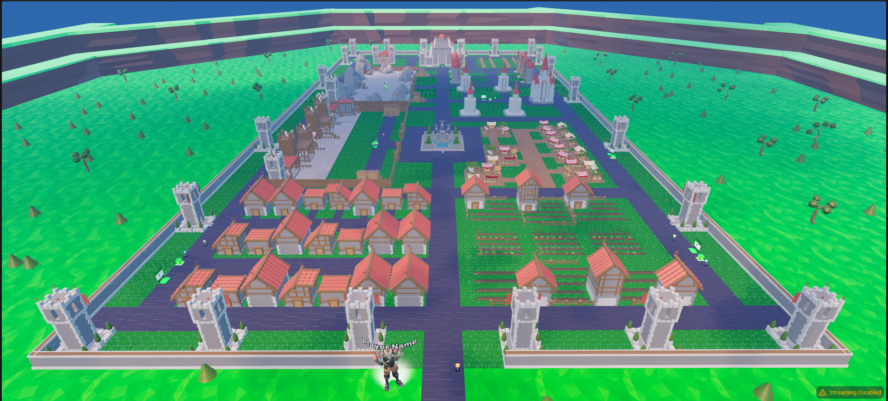

# KINGDOM VILLAGE TYCOON

*A kingdom-building tycoon game developed using Unreal Editor for Fortnite (UEFN) and the Verse programming language.*

*Front view of the completed Kingdom Village after unlocking its buildings and structures.*

## Overview

**Kingdom Village Tycoon** is a progression-based game where players earn in-game currency and gradually unlock buildings to construct a medieval-inspired village.

Players begin by claiming one of four plots. Each player develops their own kingdom by hitting money crates, collecting generated currency, and purchasing buildings. Everyone can see the claimed plots, but only the owner can interact with the gameplay systems on their plot.

The game combines UEFN's built-in gameplay devices with custom Verse code to implement its interactions and progression systems.

## Gameplay Preview
Watch a gameplay demonstration of Kingdom Village Tycoon, showcasing plot claiming, currency generation, building purchases, and kingdom progression.
https://youtu.be/F-wlVsVt94k

<!-- After uploading a short preview GIF to assets/gameplay-preview.gif, replace the sentence above with:

Alternatively, link to a longer gameplay video hosted externally. -->

## Play the Game

Kingdom Village Tycoon is playable in Fortnite.

**Island Code: `8576-9889-8811`**

1. Launch Fortnite.
2. Open Search or Discover.
3. Enter the island code **8576-9889-8811**.
4. Select **Kingdom Village Tycoon** to play.

## Gameplay

The objective is to earn enough currency to unlock the available buildings and complete the kingdom.

1. **Claim a plot:** Select one of four available plots using its claim button.
2. **Earn currency:** Hit money crates and collect currency generated by Money Collectors.
3. **Purchase structures:** Step onto purchase buttons to unlock buildings and expand the village.
4. **Progress through the kingdom:** New purchase opportunities become available as players complete parts of each stage.
5. **Complete and rebirth:** After finishing the kingdom, players can reset their village progression to gain a permanent earnings bonus, capped at **+40%**.

## Technologies Used

| Technology | Purpose |
|---|---|
| **Unreal Editor for Fortnite (UEFN)** | Development environment used to build the map, place objects, and configure UEFN's built-in gameplay devices. |
| **Verse** | Programming language used to implement custom gameplay logic, manage game state, and coordinate device interactions. |

## Source Code and Documentation

This repository contains the game's Verse source code and documentation, including explanations for developers unfamiliar with UEFN and Verse.

| Location | Contents |
|---|---|
| [`docs/01-Game-Overview.md`](docs/01-Game-Overview.md) | Player experience, gameplay mechanics, and progression |
| [`docs/02-UEFN-and-Verse.md`](docs/02-UEFN-and-Verse.md) | Introduction to UEFN, Verse, and the devices used |
| [`docs/03-System-Architecture.md`](docs/03-System-Architecture.md) | Major systems, responsibilities, and dependencies |
| [`docs/04-Gameplay-Systems.md`](docs/04-Gameplay-Systems.md) | Detailed implementation of key gameplay systems |
| `src/` | Verse source code |
| `assets/` | Screenshots and visual documentation |

## More Projects

Explore my other Fortnite creations on my [Fortnite.gg Creator Profile](https://fortnite.gg/creator/creativenight).
