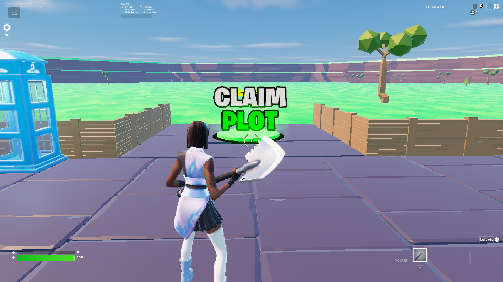
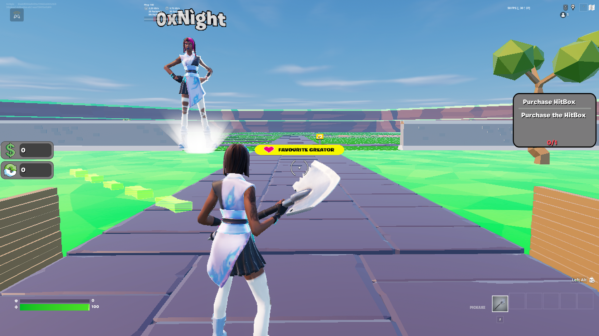
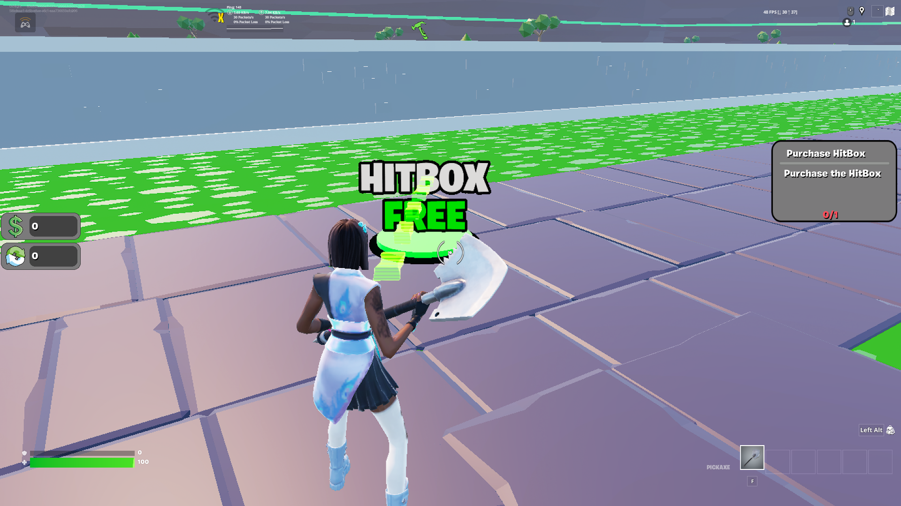
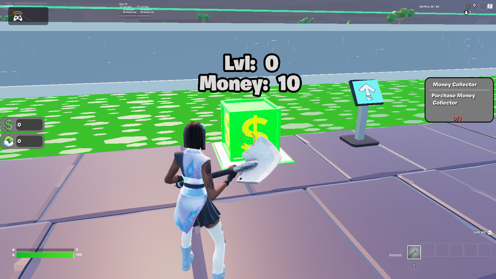
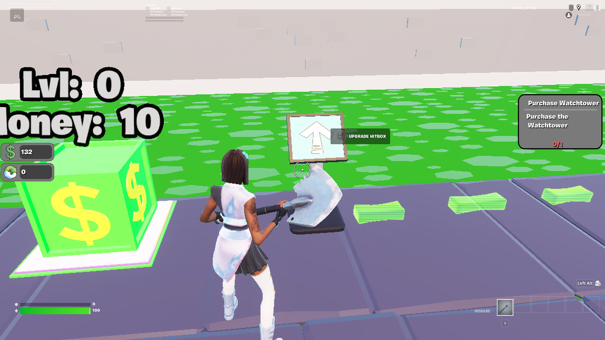
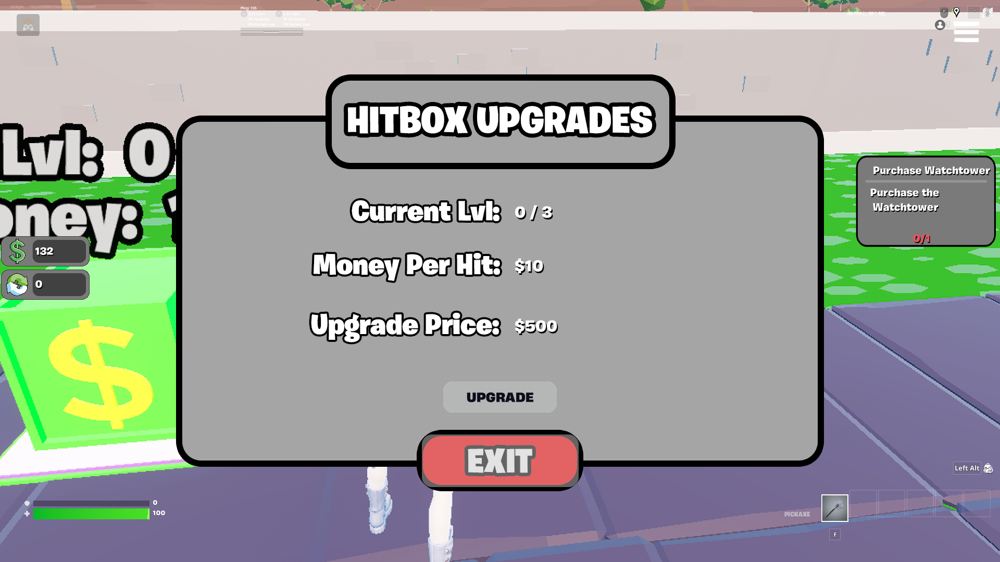
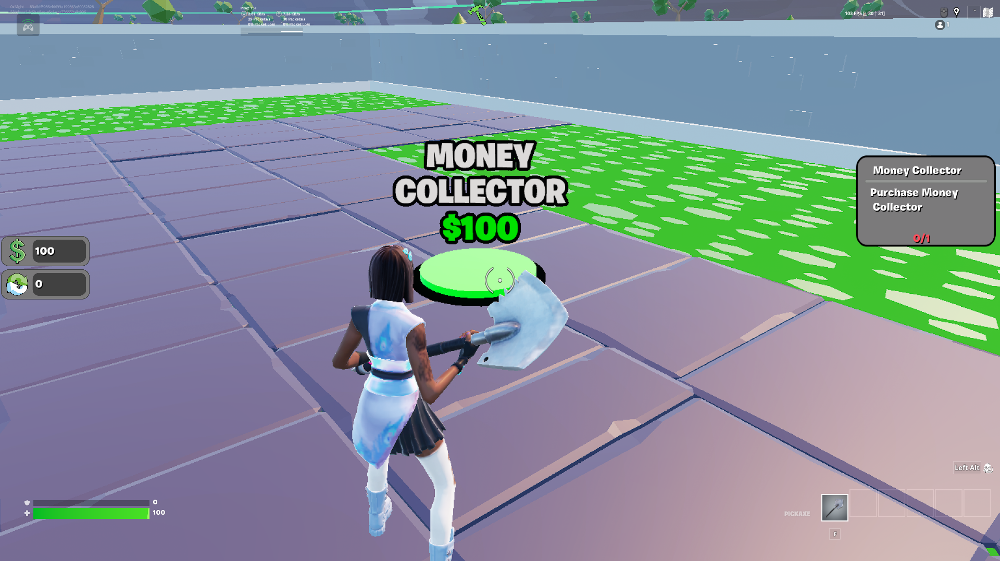
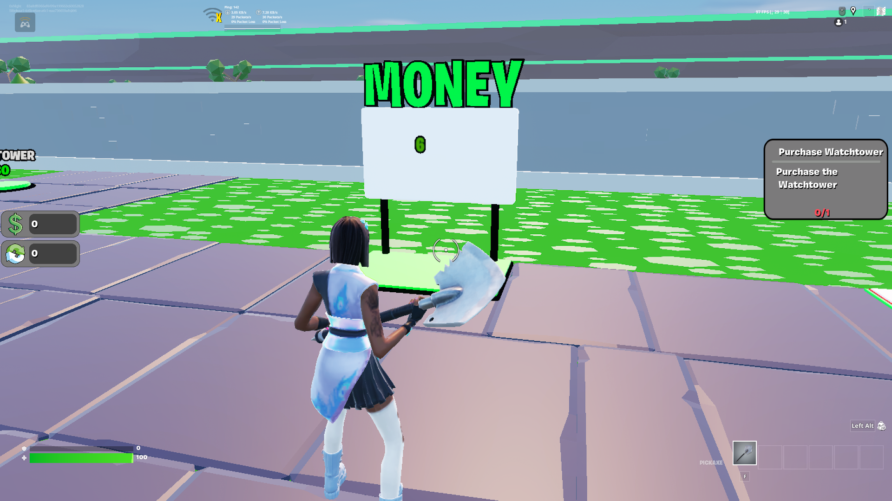
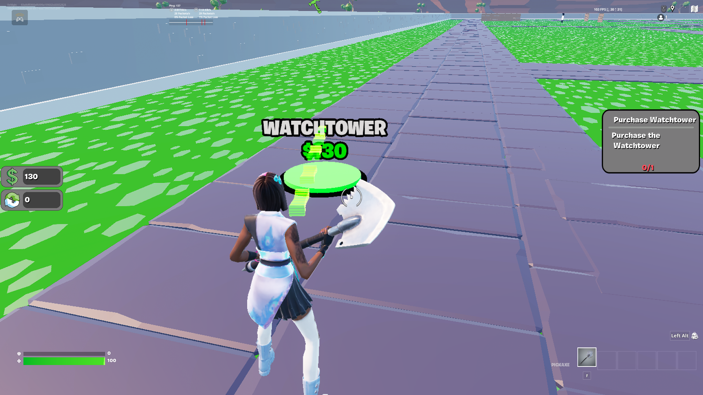
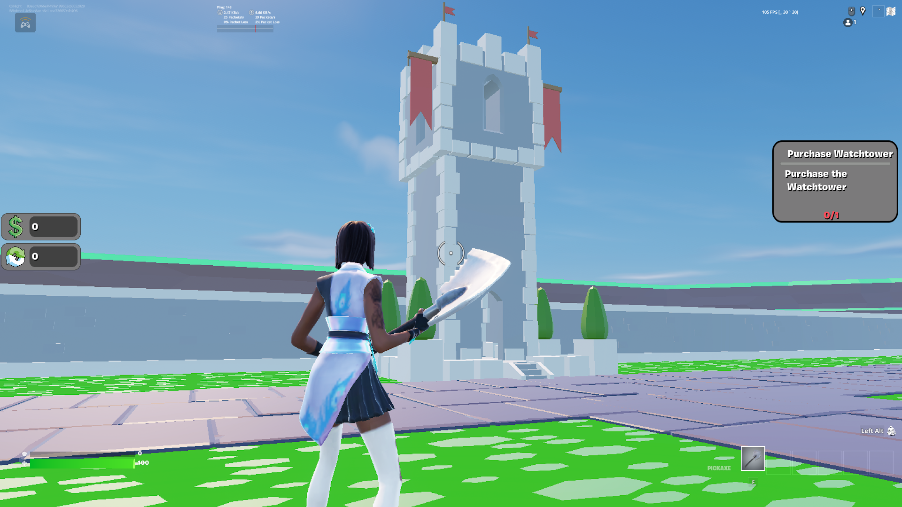

# KINGDOM VILLAGE TYCOON — Game Overview

This document explains how **Kingdom Village Tycoon** works from the player's perspective. It focuses on gameplay and progression; the Verse code, UEFN devices, and technical architecture are documented separately.

## 1. Game Objective

Kingdom Village Tycoon is a multiplayer kingdom-building game in which players claim their own plot, earn in-game currency, and gradually purchase buildings and structures to develop a medieval-inspired village.

Players begin with an undeveloped plot and unlock structures in stages. After completing their village, they can **rebirth** to restart progression with an increased currency-earning bonus.

## 2. Joining the Game and Claiming a Plot

The map contains **four claimable plots**. On joining, a player approaches an available plot's claim button and steps on it to claim that plot.

*A player approaches an available plot's claim button.*

Once claimed, the player's plot is revealed. Other players in the same lobby can see the plot and its structures, but **only the plot owner can interact with that plot's gameplay systems**. The player's currency and rebirth counters also become visible.

*A newly claimed plot, with the currency and rebirth interfaces visible.*

## 3. Guided Introduction

First-time players receive an in-game tutorial that introduces the core mechanics. An objective panel displays the next task, while a green directional line guides the player toward the relevant purchase location.

The introductory sequence guides players through:

1. Claiming a plot.
2. Unlocking a **free hitbox**.
3. Earning money by hitting the hitbox.
4. Purchasing a **Money Collector** for **$100**.
5. Purchasing a **Watchtower** for **$130** and then completing the required additional tower purchases.

After the required tutorial purchases are completed, the objective panel and guidance line disappear. Players then continue developing their village independently. **The tutorial does not repeat after a rebirth.**

*The tutorial highlights the next purchase. The first hitbox is free to unlock.*

## 4. Earning Currency

Players have two main ways to earn currency: actively hitting a hitbox and collecting money generated over time.

### 4.1 Hitboxes

After unlocking a hitbox, a player can strike it to earn money per hit. A hitbox displays its relevant statistics in the game world.

*The first hitbox becomes available as a source of active earnings.*

Each hitbox has **3 upgrade levels**. Higher levels increase the currency earned per hit. Players access these upgrades using a nearby upgrade stand and its interaction interface.

*The upgrade stand sits near the hitbox.*

*Interacting with the stand opens the interface for upgrading hitbox earnings.*

Additional hitboxes become available as the village develops. Later hitboxes offer higher earning ranges than earlier ones, supporting progression toward more expensive purchases.

### 4.2 Money Collector

The tutorial next guides the player to unlock the Money Collector for **$100**. In the introductory sequence, the player earns this amount by hitting the first hitbox ten times.

*The Money Collector is available to purchase once the player has enough currency.*

Once unlocked, the Money Collector **automatically accumulates currency over time**. Players collect the accumulated amount by stepping on its green collection area.

It begins by accumulating **$1 per second**. As the player purchases more structures, the accumulation rate increases according to the village's progression. The increases are not constant throughout the entire game: later stages can provide larger income increases than early stages.

*The unlocked collector provides a second, passive source of currency.*

## 5. Purchasing Buildings and Expanding the Village

Players purchase buildings and other structures by **stepping on green purchase buttons** placed around their plot. Each purchase has a displayed price. The game checks whether the player has enough currency to make the purchase.

When a purchase succeeds, the purchased structure is revealed on the player's plot.

For example, the introductory Watchtower costs **$130**:

*The Watchtower purchase button and tutorial objective.*

*The Watchtower after it has been unlocked.*

### 5.1 Unlocking New Purchase Sets

Not all purchase buttons are available from the beginning. New groups of purchases become visible as the player buys structures from the currently available set.

**Progression rule:** When a player purchases **at least 50% of the currently visible, available purchases**, the next set becomes available.

For example:

- If **4** purchases are currently available, purchasing **2** reaches the 50% threshold and reveals the next set.
- If **6** purchases are currently available, purchasing **3** reaches the threshold and reveals the next set.

As newly unlocked purchase options become visible, they contribute to the next stage of progression. This staged approach gradually expands the number of structures that players can build and helps guide development of the village.

## 6. Multiplayer and Plot Ownership

The map supports up to **four claimed plots** at a time. Each player develops their own kingdom, while being able to see the villages developed by other players in the lobby.

Ownership limits gameplay interactions to the player's own plot. A player can observe someone else's village but cannot use that player's plot interactions to purchase or progress it.

## 7. Saved Progress

The game includes **persistent player progression**, so players do not have to restart their entire journey whenever they leave and rejoin. The precise data fields and save/load implementation will be described in the technical documentation after reviewing the source code.

## 8. Completing the Kingdom and Rebirth

Once a player has purchased all the buildings needed to complete their kingdom, they can use a **rebirth** option.

Rebirthing:

- Resets the player's currency to **$0**.
- Resets village development, requiring the player to claim a plot again and rebuild.
- Increases the displayed rebirth count by **1**.
- Grants a permanent progression bonus to earnings, up to a maximum of **+40%**:
  - First rebirth: **+20%** earnings.
  - Second rebirth: **+40%** earnings in total.
  - Further rebirths: the earnings bonus remains at **+40%**.
- Does **not** repeat the introductory tutorial.

Rebirth provides a way to restart the building progression with faster earning potential while retaining the player's rebirth advancement.

## 9. Gameplay Summary

The main gameplay loop is:

**Claim a plot → Unlock a hitbox → Earn currency → Buy structures → Increase earning power → Complete the kingdom → Rebirth.**

Together, plot ownership, guided onboarding, active and passive income, staged purchase availability, saved progression, and rebirth form the core experience of Kingdom Village Tycoon.

---

*For the implementation, see the companion documentation on UEFN and Verse, system architecture, and individual gameplay systems.*
