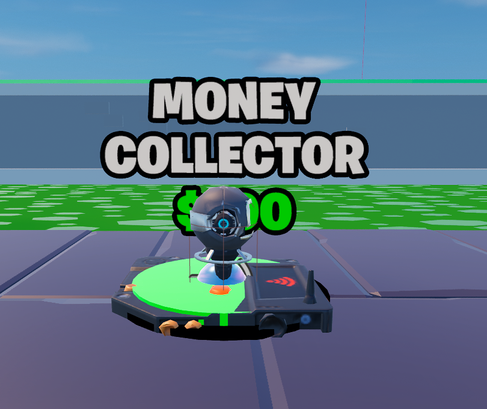
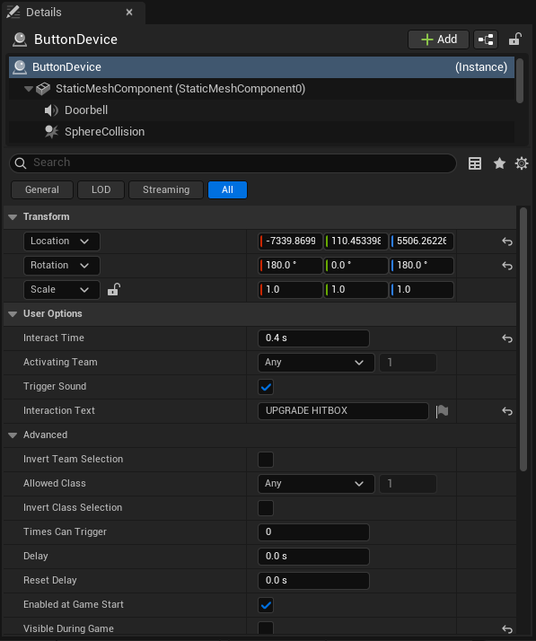
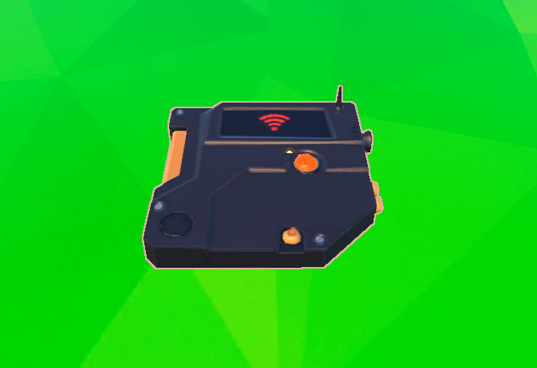
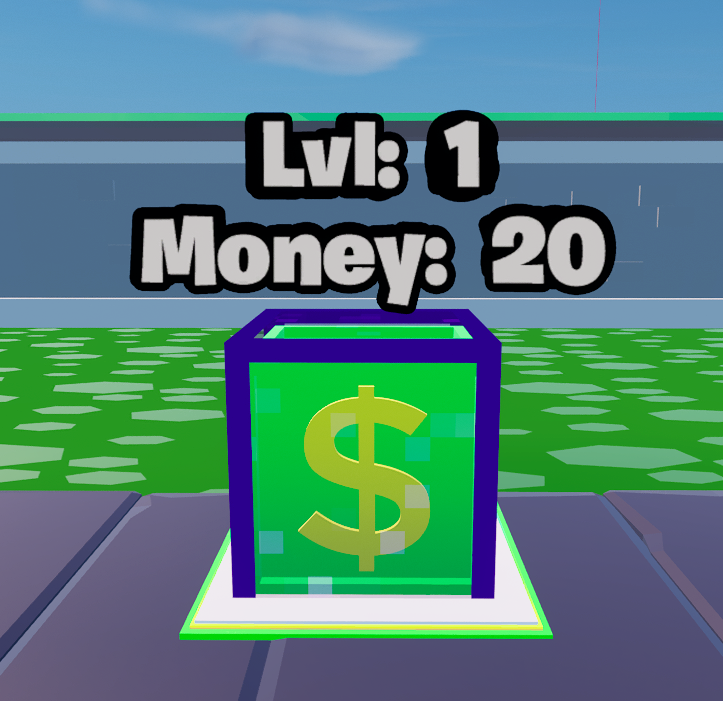
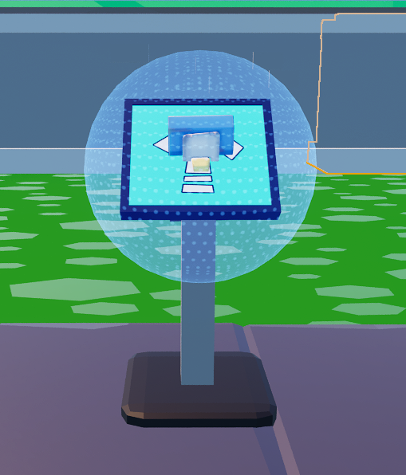
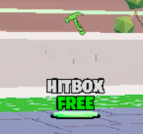
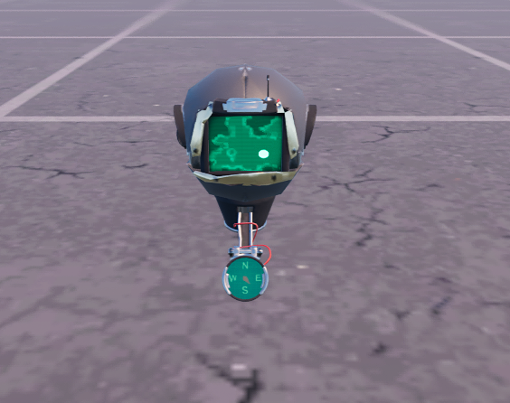
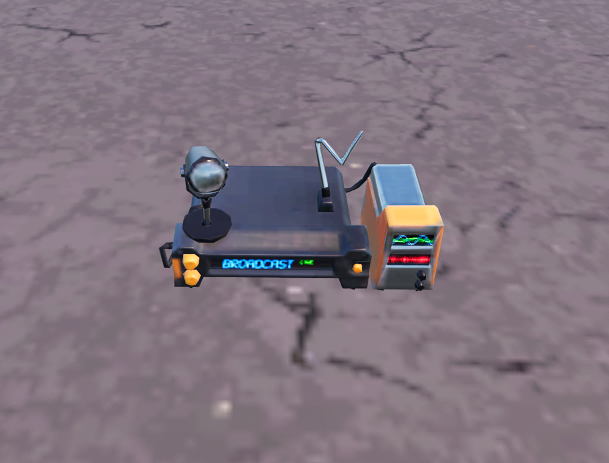
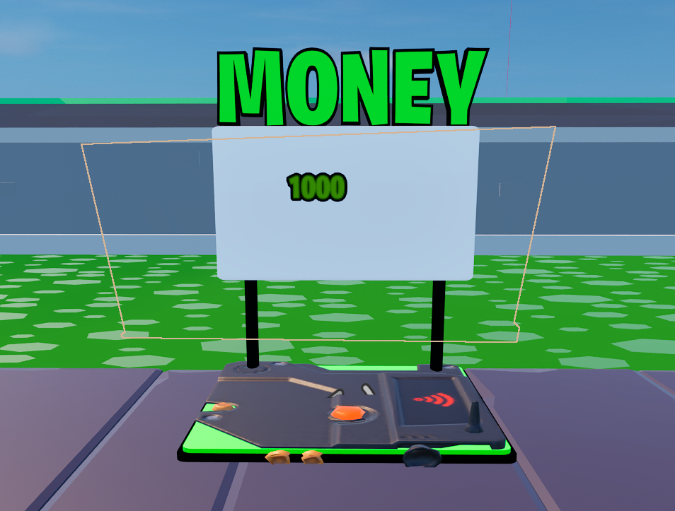
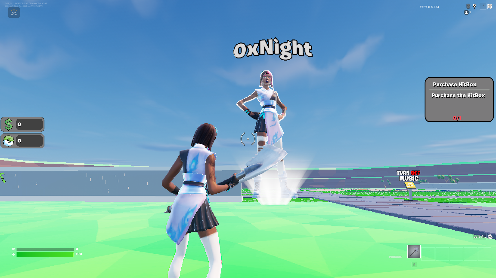

[Uploading 02-UEFN-and-Verse.md…]()
# UEFN and Verse — Kingdom Village Tycoon

This document introduces the development tools behind **Kingdom Village Tycoon**. It is intended for software developers who may be familiar with programming but have never used Unreal Editor for Fortnite (UEFN) or Verse.

The [Game Overview](01-Game-Overview.md) explains what players do. Here, the focus is on the editor, programmable devices, and the way player interactions connect to custom code.

## 1. What Is UEFN?

**Unreal Editor for Fortnite (UEFN)** is an environment for building interactive experiences that run in Fortnite. Developers use it to assemble game worlds, place props and structures, configure built-in gameplay devices, and integrate custom logic written in Verse.

For Kingdom Village Tycoon, UEFN contains the kingdom environment, claim areas, purchase locations, hitboxes, collection areas, and other placed objects.


*An editor view showing several devices positioned around a purchase location.*

## 2. What Is Verse?

**Verse** is a programming language used to implement custom behavior in UEFN. Verse code can manage game state, respond to events, update player interfaces, and communicate with supported devices in the world.

In Kingdom Village Tycoon, Verse implements the logic behind systems such as plot ownership, currency, purchases, hitboxes, tutorial progression, and rebirths. UEFN devices provide interaction points and display behavior; Verse coordinates the game's rules.

## 3. Understanding Gameplay Devices

A **device** is a configurable object or gameplay component placed in UEFN. Devices can detect interactions, display information, identify players, or trigger other actions. Many built-in devices have settings that are adjusted in the editor without writing code.

For a developer from a conventional software background, a useful analogy is that devices act as configurable inputs and outputs while Verse supplies application-specific control logic. The analogy is not exact, but it helps explain how the pieces fit together.

### 3.1 Device Configuration

Selecting a device in the editor opens a **Details** panel containing its settings. Depending on the device, options may include visibility during gameplay, interaction text, activation behavior, or who can interact with or view it.


*Example of a device's configurable settings in UEFN.*

### 3.2 Editor Visibility vs. Gameplay Visibility

Some devices can be configured to remain invisible to players while still functioning. This is why a player may see a green purchase pad without seeing the underlying Trigger Device that detects when they step on it.

The editor screenshots show implementation objects that do not necessarily appear in the same way during a live game.

## 4. Devices Used in Kingdom Village Tycoon

### 4.1 Trigger Device — Detecting Purchase and Collection Actions

A **Trigger Device** emits an event when activated under its configured conditions. In this game, triggers are used for interactions such as stepping on a purchase button or the Money Collector's green collection area.

Verse subscribes to trigger events and runs the relevant game logic when those events occur. For purchases, that includes checking whether the player has enough currency for the associated structure.


*Trigger Device shown in the editor.*

### 4.2 Prop Manipulator Device — Detecting Hitbox Damage

A **Prop Manipulator Device** can affect properties of props within its configured area and expose events related to those props, including damage.

Kingdom Village Tycoon positions a Prop Manipulator over a hitbox crate to detect when the crate is struck. The game uses the resulting interaction as part of its currency-earning logic.


*The Prop Manipulator positioned around the hitbox crate in the editor.*

### 4.3 Button Device — Opening Upgrade Interfaces

A **Button Device** provides an interaction that a player actively activates, as opposed to merely stepping onto a trigger area.

In Kingdom Village Tycoon, a Button Device is positioned at the hitbox upgrade stand. Players interact with it to open the interface used to upgrade their hitbox's earnings.


*The upgrade stand's interaction button in the editor.*

### 4.4 Beacon Device — Marking Available Purchases

A **Beacon Device** displays a visible marker that helps players locate points of interest. The game's beacons display a **green hammer icon** over building purchase locations.

The marker is removed after the corresponding building has been purchased.


*The Beacon Device as it appears while configuring the map in UEFN.*


*A purchase location marked by the green hammer icon during gameplay.*

### 4.5 Map Indicator Device — Tutorial Navigation

A **Map Indicator Device** can create location markers and objective guidance. In Kingdom Village Tycoon, it provides the **green directional guidance line** that points players toward their current tutorial target.

It works alongside the tutorial's objective display to help first-time players locate their next purchase.


*The Map Indicator Device in the editor.*

### 4.6 Tracker Device — Tutorial Objectives

A **Tracker Device** can display and monitor gameplay objectives. The game uses trackers to present tutorial steps such as **Purchase Watchtower** and show the player's objective progress.


*The Tracker Device in the editor.*

### 4.7 HUD Message Device — Player Feedback

A **HUD Message Device** displays messages on a player's screen. Kingdom Village Tycoon uses it to provide immediate feedback, including when a purchase is unaffordable.

For example, a player who has **$50** and attempts to purchase a **$100** structure may receive a message such as **“YOU CAN'T AFFORD THIS.”**


*The HUD Message Device in the editor.*

### 4.8 Billboard Device — In-World Information

A **Billboard Device** displays text within the game world. In this project, a billboard is placed with the Money Collector to present information at the collection point.


*The Money Collector's Billboard and Trigger Devices as placed in UEFN.*

### 4.9 Player Reference Device — Showing Plot Ownership

A **Player Reference Device** can store a reference to a player and present player-related information or visuals. In Kingdom Village Tycoon, claiming a plot causes the corresponding device to display the owner's character in front of their claimed plot.


*The claimed plot displays its owner's character.*

### 4.10 Verse-Authored Devices — Custom Gameplay Logic

UEFN also supports **Verse-authored devices**, created from custom Verse code. Once built and placed in the world, these devices can expose editable references and configuration values in the Details panel.

This connects code to the scene: rather than hard-coding every placed object, a developer can assign device references in the editor and use them during gameplay.


*A Verse-authored device in the editor.*

## 5. How UEFN Devices Communicate with Verse

Kingdom Village Tycoon uses an **event-driven interaction pattern**. Verse subscribes to events emitted by devices and runs functions when those events occur.

For a building purchase, the conceptual sequence is:

1. A player steps onto a purchase pad.
2. The configured Trigger Device fires an event.
3. The subscribed Verse function runs.
4. The game's purchase logic checks the relevant requirements, including the player's currency.
5. A successful purchase unlocks the building; an unsuccessful purchase can display feedback through a HUD Message Device.

An equivalent pattern applies when a Prop Manipulator detects a hitbox being struck, except that the event leads into the currency-earning logic.

### Editable References and Event Subscriptions

Verse supports `@editable` properties, allowing references to placed devices to be configured in UEFN. Device events can be connected to code through methods such as `Subscribe()`.

The following is a **general illustrative pattern**, not a quotation from Kingdom Village Tycoon's source code:

```verse
@editable
PurchaseTrigger : trigger_device = trigger_device{}

OnBegin<override>()<suspends>:void =
    PurchaseTrigger.TriggeredEvent.Subscribe(HandlePurchaseTriggered)

HandlePurchaseTriggered(MaybeAgent:?agent):void =
    # Validate the activating player and process the purchase here.
```

The precise handler signatures, validations, and dependencies in the actual project will be documented after reviewing the source files.

## 6. Verse Project Organization

The project's Verse files are grouped by purpose:

```text
Config/
  hitbox_config.verse
  prop_config.verse
  tracker_config.verse

Persistence/
  player_info.verse
  prop_info.verse
  tutorial_info.verse

TycoonElements/
  base_manager.verse
  button_manager.verse

UserInterface/
  barracks_hitbox_upgrade_ui.verse
  common_weaponshop_ui.verse
  epic_weaponshop_ui.verse
  farm_hitbox_upgrade_ui.verse
  gold_resource_ui.verse
  houses_hitbox_upgrade_ui.verse
  markets_hitbox_upgrade_ui.verse
  quarry_hitbox_upgrade_ui.verse
  rare_weaponshop_ui.verse
  temple_hitbox_upgrade_ui.verse
  traininggrounds_hitbox_upgrade_ui.verse
  tutorial_ui.verse
  ui_manager.verse
  uncommon_weaponshop_ui.verse
  wood_hitbox_upgrade_ui.verse

game_manager.verse
hitbox_manager.verse
playergoldpopup.verse
test.verse
tutorial.verse
utility_module.verse
```

At a high level, the names suggest that configuration, persistence, tycoon interactions, and user interfaces have been separated into different groups. Detailed responsibilities and actual dependencies will be verified from the code in the [System Architecture](03-System-Architecture.md) documentation.

## 7. Development and Testing Workflow

The game's development workflow involves:

1. Building and configuring the map and its devices in UEFN.
2. Writing custom Verse code in Visual Studio Code.
3. Building Verse code from UEFN.
4. Launching play sessions to test interactions and progression.
5. Troubleshooting with `Print()` statements, editor output, and repeated gameplay tests.

Testing the interaction between devices and Verse is especially important because correct code also depends on device placement, event configuration, and editable references assigned in the editor.

## 8. Further Reading

- [Getting Started with Devices — Epic Games](https://dev.epicgames.com/documentation/fortnite/getting-started-with-devices-in-fortnite)
- [Programming with Verse in UEFN — Epic Games](https://dev.epicgames.com/documentation/fortnite/programming-with-verse-in-unreal-editor-for-fortnite)
- [Editable Properties in Verse — Epic Games](https://dev.epicgames.com/documentation/fortnite/editable-properties-in-verse)
- [Coding Device Interactions in Verse — Epic Games](https://dev.epicgames.com/documentation/fortnite/coding-device-interactions-in-verse)

---

**Next:** The system architecture documentation will explain how the project's actual Verse modules depend on one another, own player state, handle purchases, and coordinate game progression.
