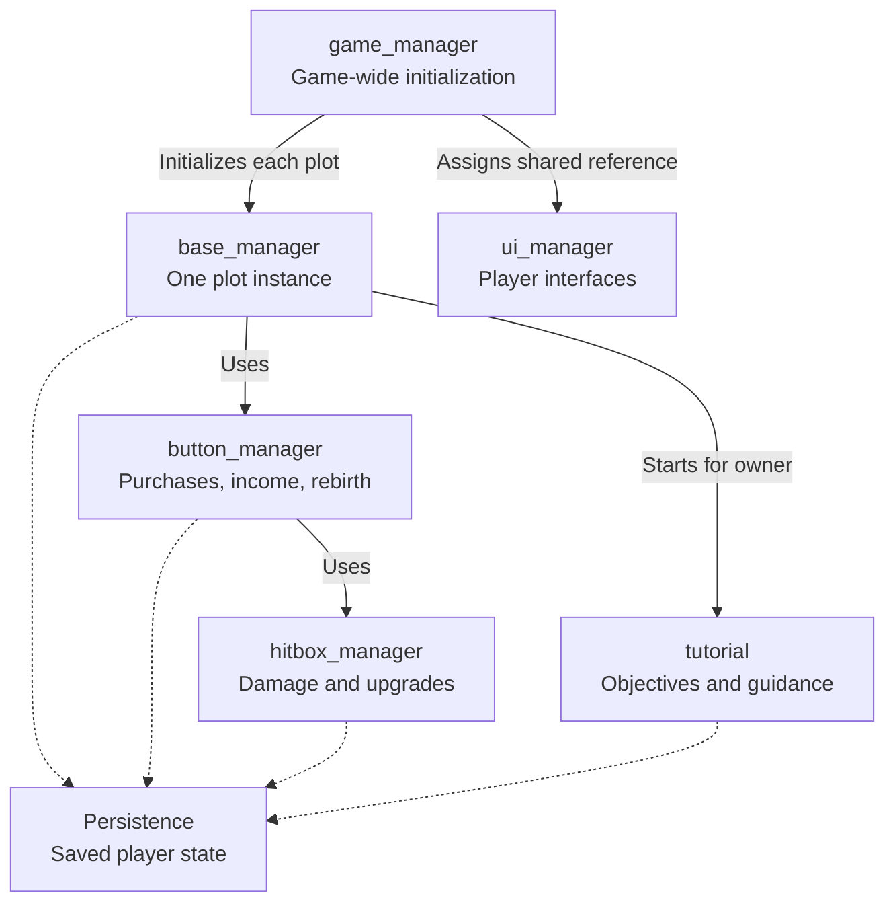
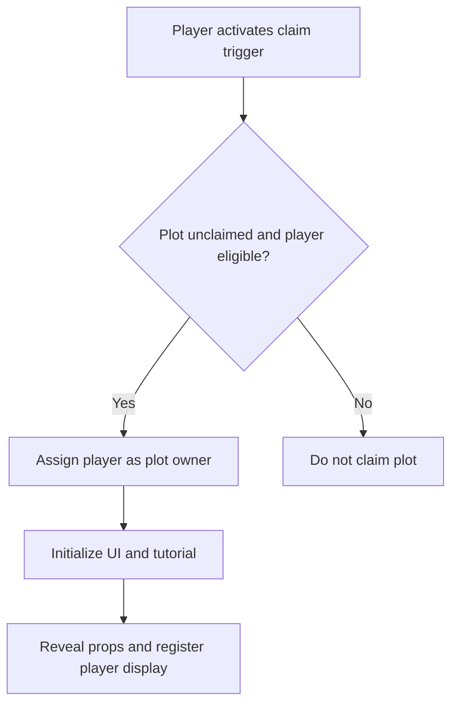
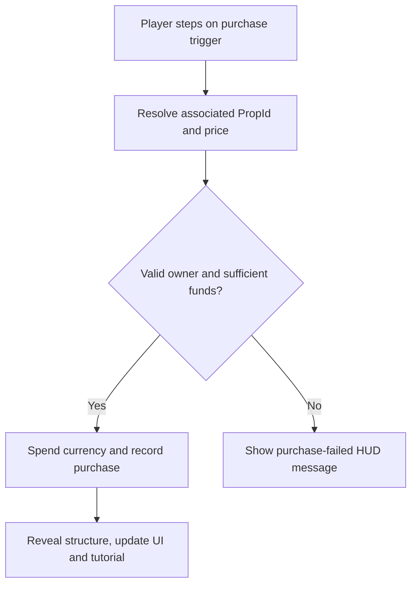

# System Architecture — Kingdom Village Tycoon

This document explains how the core Verse systems in **Kingdom Village Tycoon** work together. It is intended for software developers who may be unfamiliar with Unreal Editor for Fortnite (UEFN). For the player experience, see the [Game Overview](01-Game-Overview.md); for background on devices and Verse, see [UEFN and Verse](02-UEFN-and-Verse.md).

The architecture below is based on the supplied Verse source, including `game_manager`, `base_manager`, `button_manager`, `hitbox_manager`, the persistence files, the tutorial, UI manager, and relevant configuration files. This is a description of the current implementation, not a claim that the project uses a particular formal architectural framework.

## 1. High-Level Design

The game uses **Verse-authored devices** that coordinate UEFN's built-in devices and game props. One top-level game manager configures multiple plot managers. Each plot has its own claim and purchase interactions; player progression is stored separately from the temporary plot assignment.



Solid arrows describe direct manager relationships; dotted arrows represent calls into the persistence functions. The diagram omits individual built-in UEFN devices to keep the main relationships readable.

### Main Responsibilities

| Component | Primary responsibility |
|---|---|
| [`game_manager.verse`](../src/game_manager.verse) | Game-wide startup, shared references, player join/leave events, temporary player statistics, audio, and awards |
| [`TycoonElements/base_manager.verse`](../src/TycoonElements/base_manager.verse) | Claiming and releasing one plot, identifying its owner, revealing/hiding the plot, and initializing owner-specific behavior |
| [`TycoonElements/button_manager.verse`](../src/TycoonElements/button_manager.verse) | Purchase interactions, purchase validation, progression availability, money collection, rebirth, and additional shop interactions |
| [`hitbox_manager.verse`](../src/hitbox_manager.verse) | Hitbox damage events, earnings, level upgrades, and upgrade menu interactions |
| [`tutorial.verse`](../src/tutorial.verse) | Guided first-time objectives and objective markers |
| [`UserInterface/ui_manager.verse`](../src/UserInterface/ui_manager.verse) | Central access to currency, tutorial, hitbox upgrade, and weapon-shop interfaces |
| `Persistence/` | Saved currency, purchases, tutorial progress, rebirths, and hitbox levels |
| `config/` | Prices and reward values used by gameplay logic |

## 2. Game Startup and Dependency Wiring

The `game_manager` is a Verse `creative_device` with an editable `Bases` array containing the plot managers placed in the UEFN level. Its `OnBegin` method subscribes to player join events, processes players already in the session, and initializes each base.

For every base, it supplies shared references such as the UI manager, HUD feedback devices, audio devices, item granters, and accolade devices. It also passes dependencies to nested managers, for example:

```verse
set Base.Owner = Self
set Base.UIManager = UIManager
set Base.ButtonManager.UIManager = UIManager
set Base.ButtonManager.HitBoxManager.UIManager = UIManager
```

It then calls `Base.InitPlot()`. This initial setup hides the base's starting props by moving them below the playable area. In this design, **the game manager coordinates shared setup while each base manager owns the behavior of one plot**.

The references are configured through UEFN's editable properties. A working map therefore depends on both the Verse source and the correct references assigned to devices in the editor.

## 3. Player State: Temporary vs. Persistent

The code separates two kinds of player state:

| State type | Storage | Examples | Lifetime |
|---|---|---|---|
| Temporary session state | `playerstats`, tracked in `game_manager.PlayerStatsMap` | Current player reference and claimed `base_manager` | Current play session |
| Persistent progression | `weak_map(player, player_info)` in `Persistence/player_info.verse` | Money, purchases, rebirths, hitbox upgrades, tutorial information | Intended to survive between sessions |

The temporary `playerstats` class includes `HasClaimedBase`, which prevents a player from claiming another plot while already assigned to one. The persistable `player_info` class holds progression values such as `Money`, `Rebirths`, `PlayersCurrentPropIndex`, `MoneyCollectorLevel`, the per-area hitbox levels, `PropsInfo`, and `Tutorial`.

To update a persistable value, helper functions construct and assign an updated `player_info` value to the weak map. For example, the persistence module exposes `GrantMoney`, `SpendMoney`, `GetMoney`, and functions for purchase and hitbox state.

### Saved Purchase Data

`prop_info.verse` models each structure with a stable string identifier and purchased flag:

```verse
tycoonprops<public> := struct<persistable>:
    PropId : string = ""
    IsPropBought : logic = false
```

`player_info.PropsInfo` contains an array of these entries. This lets the game check a purchased structure by `PropId` when reloading a plot or validating progression.

The tutorial has a separate persistable array of `StepId` and `IsPropBought` values. Keeping tutorial state distinct from general purchase state supports preserving tutorial completion even when a rebirth resets the village.

## 4. Plot Claiming and Release

Each `base_manager` owns a `ClaimPlotTrigger` and subscribes to its `TriggeredEvent`. When a player steps onto the claim area, `OnPlotClaimed` checks that the plot is unclaimed and that the player can claim a base.



The successful claim also disables the plot's claim trigger, hides its claim button and related props, registers the player with a Player Reference Device, and starts monitoring available purchases. It assigns the owning player to the `button_manager`, `hitbox_manager`, and `tutorial` device for that plot.

### Revealing and Hiding Props

The implementation initially moves props downward by a configured `HiddenOffset`. When the plot is revealed, the props move back toward their intended positions using `MoveTo`. The same underlying pattern is used to reveal purchased buildings.

### Leaving the Game

The game manager monitors player removal events and invokes the owned plot's cleanup path. The base manager clears its owner, hides plot content, re-enables the claim trigger, clears the Player Reference Device, and asks downstream managers to remove player-specific state and visuals.

The persisted progression remains separate from this temporary plot ownership. A returning player can claim an available plot and have purchased structures revealed based on saved data.

## 5. Building Purchases

Each purchasable structure is represented by a configured `buyable_props` entry that includes an identifying `PropId`, its purchase trigger, visual purchase elements, and the props that become visible when bought.

During initialization, `button_manager` subscribes each `PropTrigger.TriggeredEvent` to `OnPropPurchased`, passing the matching `buyable_props` entry. The manager also starts with purchase triggers and their associated visuals disabled or hidden until progression makes them available.



The manager uses the price configuration to find the required amount. On a valid purchase it deducts currency, marks the structure as bought in persistent data, signals tutorial progress, updates the player's resource UI, plays or awards configured feedback, disables the purchase trigger, and reveals the corresponding props.

`prop_config.verse` separates structure prices from the purchase handler. For example, the starting hitbox is free, the first Money Collector costs **$100**, and the first Watchtower costs **$130**.

### 5.1 Unlocking New Purchase Groups

The `MonitorPropButtonAvailability` task checks which purchases should be shown to the plot owner. Purchases are grouped by `PropDisplayIndex`. The function counts purchases in the **current index group**, checks how many have been bought, and advances the player's index when its completion ratio is at least 0.50:

```verse
CompletionRatio := TrueCount / ArrayCount
if (CompletionRatio >= 0.50):
    if (IncrementPlayersCurrentPropIndex[ActualPlayer]){}
```

This implementation detail is worth distinguishing from a simpler player-facing explanation: **the calculation uses entries at the current `PropDisplayIndex`, not an explicit count of every visible purchase across earlier groups.** Previously unlocked but unpurchased buttons may remain visible. The intended gameplay outcome is staged building availability; the precise counting rule above comes from the code.

The monitor runs periodically (with a `Sleep(0.4)` in the supplied implementation), so visibility is updated shortly after purchase state changes rather than through a single direct call for every purchase.

## 6. Currency Systems

### 6.1 Active Income: Hitboxes

The `hitbox_manager` handles the player's active source of income. It initializes hitbox-related devices, monitors which hitboxes are unlocked, and responds to damage events through `OnDamaged`.

Its responsibility is to determine the earnings from the relevant hitbox and level, apply applicable rebirth bonuses, grant currency through the persistence functions, and update in-game feedback.

The `Config/hitbox_config.verse` file keeps level rewards and upgrade prices separate from hit-event handling. For the Houses hitbox:

| State | Currency per hit | Price to reach state |
|---|---:|---:|
| Level 0 | $10 | Starting value |
| Level 1 | $20 | $500 |
| Level 2 | $40 | $1,000 |
| Level 3 | $80 | $2,000 |

Thus, this hitbox has **three purchasable upgrades** and four possible payout values including the initial level. Other areas use their own configured amounts.

### 6.2 Passive Income: Money Collectors

`button_manager` also handles passive income. Its `MoneyCollection` task accumulates money over time according to the player's `MoneyCollectorLevel` and progression, and uses the appropriate billboards and triggers for unlocked collectors.

Players collect accumulated earnings by entering the collection trigger. The handler credits money to the player and updates the collector display. The game supports multiple collector instances unlocked across different stages.

The income rate is configured to grow with the village's progression; it is not simply a constant reward for every building at all stages.

## 7. Tutorial and User Interface

The `tutorial` device is assigned the plot owner after a successful claim. It checks persisted tutorial information to determine the next objective and uses tracker and map indicator devices to display the task and direct the player.

The tutorial includes steps for unlocking the initial hitbox, Money Collector, several Watchtowers, and a later purchase objective. It has monitoring functions that detect completed purchases and advance the objective display.

The `ui_manager` serves as a central access point for showing, updating, and closing multiple interface components, including:

- Currency and rebirth information.
- Tutorial tracker UI.
- Hitbox upgrade interfaces for different village areas.
- Weapon shop interfaces.

This avoids requiring every gameplay handler to independently construct each UI. Instead, managers can request updates through a shared UI manager reference. The current code still contains separate interface modules for different gameplay areas, which reflects the project's existing organization.

## 8. Rebirth and Reset

The rebirth action is initiated through the plot's interaction flow and handled by `button_manager`, using persistence functions in `player_info.verse`.

The persistence reset:

1. Sets money back to zero.
2. Resets the current purchase progression index and Money Collector level.
3. Resets the stored hitbox upgrade levels.
4. Recreates purchase entries with `IsPropBought = false`.
5. Preserves other saved player fields through the `MakePlayerInfo` constructor, including tutorial progress and rebirth-related values.

The game tracks whether the player has reached the first and second earnings bonuses. From the supplied gameplay rules, these add **+20%** and **+40% total** respectively; further rebirths do not increase the earnings multiplier.

Plot ownership is also cleared during the reset flow, so the player begins the next development cycle by claiming a plot again. The tutorial remains completed.

## 9. Design Choices and Tradeoffs

The following are interpretations of the code's design rather than claims about the original author's intentions.

| Approach visible in the code | Benefit | Tradeoff or consideration |
|---|---|---|
| Separate temporary player statistics from persistable `player_info` | Session ownership can be cleared without discarding progression | Requires coordination when players leave or rejoin |
| Separate managers for plots, purchases, and hitboxes | Makes major responsibilities easier to identify | Manager objects still depend on one another and require wiring |
| External configuration for prices and hitbox rewards | Gameplay values can change without rewriting each interaction handler | Identifiers and configured arrays must remain consistent |
| Stable `PropId` identifiers | Supports saved purchase state across sessions | Renaming identifiers requires care with existing save data |
| Event subscriptions for device interactions | Responds to gameplay actions rather than polling every input | Requires valid device references and subscriptions |
| Periodic monitor for purchase availability | Simple mechanism for checking staged progression | Visibility updates are polling-based and depend on the current group's data |
| Rebuilding persistable state through constructors | Preserves unchanged fields while updating selected values | New saved fields must be included in copy/reset logic where appropriate |


## 10. Reading the Source

For a technical reviewer, this is a useful reading order:

1. `game_manager.verse` — entry point and shared setup.
2. `TycoonElements/base_manager.verse` — ownership lifecycle.
3. `TycoonElements/button_manager.verse` — purchases, availability, collectors, and rebirth.
4. `hitbox_manager.verse` and `Config/hitbox_config.verse` — active income and upgrades.
5. `Persistence/player_info.verse`, `Persistence/prop_info.verse`, and `Persistence/tutorial_info.verse` — saved state.
6. `tutorial.verse` and `UserInterface/ui_manager.verse` — guided objectives and presentation.

For a closer examination of individual classes, device references, and important functions, see the next document: **`04-Gameplay-Systems.md`**.
