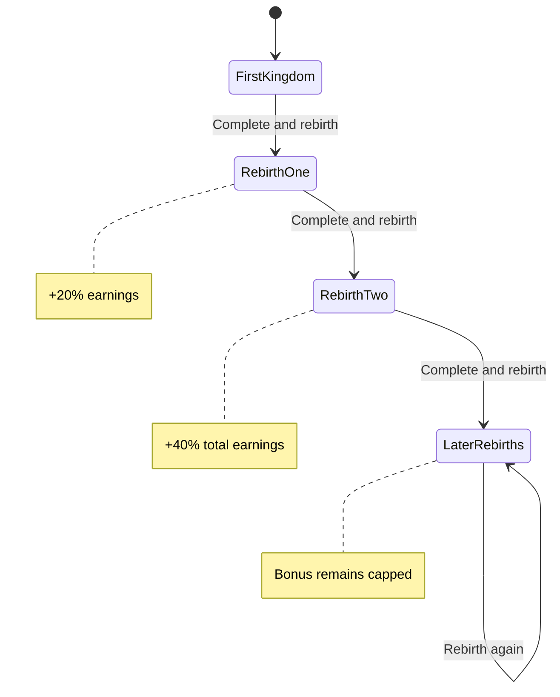

# Gameplay Systems — Kingdom Village Tycoon

This document examines how the main gameplay mechanics of **Kingdom Village Tycoon** are implemented in Verse. It focuses on the responsibilities of selected functions, how UEFN device events trigger code, how data changes, and the checks used to protect player-specific actions.

It complements the [Game Overview](01-Game-Overview.md), [UEFN and Verse introduction](02-UEFN-and-Verse.md), and [System Architecture](03-System-Architecture.md). The excerpts below are intentionally short and taken from the supplied project source. They are not standalone programs.

## 1. Plot Management

**Primary source:** `src/TycoonElements/base_manager.verse`  
**Related source:** `src/game_manager.verse`, `src/Persistence/player_info.verse`

### Purpose

The plot system lets each player claim one of four available plots and prevents a player from interacting with a plot belonging to someone else. The plot's manager is responsible for revealing its world objects and restoring availability when its owner leaves.

### Interaction flow

1. During startup, `base_manager.OnBegin` subscribes to `ClaimPlotTrigger.TriggeredEvent`.
2. `OnPlotClaimed` checks whether the plot status is `Unclaimed`.
3. It resolves the activating agent to a player and calls `TempStats.ClaimBase[Self]`.
4. On success, it assigns the player to the base, purchase manager, hitbox manager, and tutorial; it also initializes player-facing UI.
5. The claim trigger is disabled, the plot is revealed, and the Player Reference Device registers the owner.

The persistent player record and the temporary plot assignment are separate. In `player_info.verse`, the temporary `playerstats` object includes:

```verse
var HasClaimedBase<public>:?base_manager = false

ClaimBase<public>(Base:base_manager)<transacts><decides>:void=
    not HasClaimedBase?
    set HasClaimedBase = option{Base}
```

The `not HasClaimedBase?` condition makes claiming fail when the player already holds a base. The separate plot status check prevents claiming a plot that is already occupied.

### Revealing and cleaning up a plot

`InitPlot` moves starting props down by `HiddenOffset`. `RevealPlot` uses `MoveTo` to animate them back into view. On player removal, the base manager clears its player reference, hides the plot, re-enables claim elements, clears related UI, and triggers the purchase manager's cleanup behavior.

**Engineering concepts:** event subscriptions, state transitions, ownership checks, and separating session state from saved progress.

**Test scenarios worth verifying:** two players attempt to claim one plot; a player attempts to claim a second plot; the owner leaves and another player claims the released plot.

## 2. Building Purchase System

**Primary source:** `src/TycoonElements/button_manager.verse`  
**Related source:** `src/Config/prop_config.verse`, `src/Persistence/prop_info.verse`, `src/Persistence/player_info.verse`

### Purpose

Players step onto purchase areas to buy structures. The purchase manager connects each trigger to a configured building, checks the player's identity and funds, records the purchase, and reveals the associated props.

### Event subscription

During startup, the manager iterates over its configured purchase entries:

```verse
for (BuyableProps : PurchasableProps):
    BuyableProps.PropTrigger.TriggeredEvent.SubscribeAgent(OnPropPurchased, BuyableProps)
    BuyableProps.PropTrigger.Disable()
```

The event handler receives both the activating agent and the corresponding `buyable_props` entry. Purchase triggers begin disabled, and progression logic enables them when appropriate.

### Purchase validation

The important conditions inside `OnPropPurchased` include:

```verse
Player := player[ActualAgent]
ActualPlayer := RootPlayer?
Player = ActualPlayer
Price := PropPriceInfo.Price
PlayersGold := GetMoney[Player]
PlayersGold >= Price
SpendMoney[Player, Price]
```

This checks that the activating player is the owner of this manager's plot and has sufficient currency. `prop_config.verse` associates each `PropId` with its price; for example, the first hitbox is free, the Money Collector costs **$100**, and the first Watchtower costs **$130**.

If the conditions succeed, the handler records the purchased `PropId`, updates the tutorial and resource UI, displays successful purchase feedback, disables the purchase trigger, and animates the purchased props into place. If the checks fail, it displays the purchase-failed HUD message.

### Data changes

Purchased buildings are represented by persistent entries containing a stable identifier and a Boolean purchase flag:

```verse
tycoonprops<public> := struct<persistable>:
    PropId : string = ""
    IsPropBought : logic = false
```

When a player claims a plot on a later visit, `CheckPlayersPlot` checks the saved purchase flags and reveals previously purchased structures.

**Engineering concepts:** validation before state changes, configuration-driven pricing, persistent identifiers, event-driven interactions.

**Test scenarios worth verifying:** unaffordable purchase; another player activating the plot's purchase trigger; repeated triggering of an already purchased item; rejoining with previously purchased structures.

## 3. Building Progression and Availability

**Primary source:** `src/TycoonElements/button_manager.verse`

### Purpose

Purchase opportunities are revealed in stages so that players gradually expand the kingdom. Each purchase entry has a `PropDisplayIndex`, which groups it into a progression stage.

`MonitorPropButtonAvailability` periodically determines which purchases should be visible and interactable. It also checks how many items in the **current `PropDisplayIndex` group** are already purchased.

### Completion calculation

The following excerpt advances progression once at least half of the current group is purchased:

```verse
CompletionRatio := TrueCount / ArrayCount

if (CompletionRatio >= 0.50):
    if (IncrementPlayersCurrentPropIndex[ActualPlayer]){}
```

For example, if four entries belong to the current group, buying two reaches a ratio of `2 / 4 = 0.50` and permits progression. The handler explicitly checks `ArrayCount > 0.0` before calculating the ratio.

**Implementation detail:** the code counts entries in the current `PropDisplayIndex` group. It does **not** directly count all still-visible, unpurchased buttons across every earlier group. Earlier purchases can remain visible if they have not been bought. This distinction should be retained when describing the actual algorithm.

The monitor sleeps for `0.4` seconds between iterations; this is a polling-based visibility refresh rather than an immediate update only when a purchase occurs.

**Engineering concepts:** grouping, ratios, threshold-based progression, guard against division by zero, periodic monitoring.

**Test scenarios worth verifying:** odd-sized purchase groups; exactly 50% completion; groups with already purchased entries after rejoining; transition between successive groups.

## 4. Hitbox Earnings and Upgrades

**Primary source:** `src/hitbox_manager.verse`  
**Related source:** `src/Config/hitbox_config.verse`, `src/Persistence/player_info.verse`

### Purpose

Players earn active currency by striking hitbox crates. The hitbox manager responds to damage events, identifies the relevant hitbox, reads the player's upgrade level, calculates earnings, grants currency, and updates the UI and visual feedback.

### Hit event

The handler `OnDamaged(Agent, Crate)` checks that the agent damaging the crate matches the plot's owner. It then selects the appropriate earnings value using `Crate.HitboxNumber`, grants currency, plays hit feedback, updates the player's resource interface, and shows a money popup. A short crate animation is also started when appropriate.

The rebirth bonus is applied as a multiplier:

```verse
if (RebirthOnce = true and RebirthTwice = false):
    set RebirthBoost = 0.20
else if (RebirthOnce = true and RebirthTwice = true):
    set RebirthBoost = 0.40
```

One of the payout branches then uses the form:

```verse
GrantMoney[ActualPlayer, HousesHitAmount * (1.0 + RebirthBoost)]
```

### Configured hitbox levels

The first hitbox uses these actual configuration values:

| Level | Reward per hit | Upgrade price |
|---|---:|---:|
| 0 | $10 | Starting state |
| 1 | $20 | $500 |
| 2 | $40 | $1,000 |
| 3 | $80 | $2,000 |

There are **three purchasable upgrades** after the starting state, not ten. Each later gameplay area has its own hitbox reward and upgrade-price arrays.

### Upgrade validation

For the Houses hitbox, `UpgradeHousesHitBox(Player)` confirms that the player is the plot owner, looks up the next upgrade price, checks the available currency, spends the price, increments the saved level, plays feedback, and refreshes the relevant UIs.

**Engineering concepts:** event callbacks, configuration-based reward calculation, per-player authorization, level progression, and state-dependent UI updates.

**Test scenarios worth verifying:** unowned player damages a hitbox; insufficient upgrade funds; maximum upgrade level; payout before and after rebirth.

## 5. Money Collector

**Primary source:** `src/TycoonElements/button_manager.verse`  
**Related source:** `src/Persistence/player_info.verse`

### Purpose

The Money Collector provides passive income. The purchase manager maintains an accumulated amount, updates collector billboards, enables collection triggers for purchased collectors, and credits the accumulated amount when the owner enters a collection area.

### Accumulation loop

The `MoneyCollection` task repeatedly obtains the player's configured collector amount, applies the rebirth bonus, and increments `MoneyCollected`:

```verse
set MoneyCollected += PlayerMoneyCollectionAmount * (1.0 + RebirthBoost)
```

It then checks which collector structures are purchased and updates their Billboard and Trigger Devices. The code supports multiple Money Collector locations, from `MoneyCollector` through `MoneyCollector8`.

**Timing note:** the supplied loop ends with `Sleep(1.4)`, so although the game describes its progression values as earnings *per second*, the shown code does not itself use a precise one-second timer or elapsed-time adjustment. The exact effective rate should be measured in a playtest before claiming timing accuracy in technical documentation.

### Collection

`OnMoneyCollected` checks that the activating player owns the plot, grants the amount held in `MoneyCollected`, resets it to zero, updates the resource UI and billboards, and plays collection feedback.

**Engineering concepts:** periodic tasks, accumulator state, ownership checks, event-driven collection, and UI synchronization.

**Test scenarios worth verifying:** collect with no accumulated currency; a non-owner enters a collection trigger; leave/rejoin while currency is pending; amount gained over a measured time interval.

## 6. Rebirth System

**Primary source:** `src/TycoonElements/button_manager.verse`  
**Related source:** `src/Persistence/player_info.verse`

### Purpose

After completing a kingdom, a player can restart development through rebirth. The system resets ordinary progress while preserving the rebirth count, bonus flags, and completed tutorial history.

### Reset flow

`RebirthPlayerFunction` first checks that the activating agent is the plot owner, reads the current rebirth count, and calls the corresponding persistence reset functions. It then disables plot-specific features, clears the current plot owner, closes the resource UI, and continues the reset flow for the player.

`RebirthPlayer` reconstructs the saved purchase array with every `IsPropBought` flag set to `false`. It also resets money, progression index, Money Collector level, and hitbox upgrade levels to zero. The remaining saved fields are carried forward by the `MakePlayerInfo` constructor.

The first successful rebirth sets the first bonus flag, the second sets the second flag, and later rebirths continue increasing the count without increasing the **maximum +40% earnings bonus**.

### State transitions



This diagram describes persistent rebirth milestones, not the literal Verse class inheritance or runtime state-machine implementation.

**Engineering concepts:** selective reset, preservation of permanent progression, state transitions, and limits on bonus accumulation.

**Test scenarios worth verifying:** rebirth before completion; persistence after the first and second rebirth; tutorial remains completed; ordinary progression starts from zero.

## 7. Tutorial and Guided Objectives

**Primary source:** `src/tutorial.verse`  
**Related source:** `src/Persistence/tutorial_info.verse`, `src/UserInterface/ui_manager.verse`

### Purpose

The tutorial guides new players from their first hitbox purchase through the Money Collector, Watchtower purchases, and a later purchase objective. Trackers display current objectives, while Map Indicator devices provide direction.

### Determining the next step

On plot claim, the base manager assigns the player to the tutorial device and calls `TutorialDevice.PlayerAdded(Player)`. After a short delay, the tutorial's `DetermineTutorialProgress` checks persisted flags for each introductory purchase in order.

For example, it checks the hitbox before the collector and the first Watchtower:

```verse
HasPlayerUnlockDollarHitBox := logic{CheckIfTutorialIsCompleted[ActualPlayer, "HousesHitBox"]}
HasPlayerUnlockMoneyCollector := logic{CheckIfTutorialIsCompleted[ActualPlayer, "MoneyCollector"]}
```

The first incomplete step determines which tracker and objective marker should be active. Device completion events are subscribed through `CompleteEvent`, allowing the tutorial to react as the objective is fulfilled.

Purchase events also mark the corresponding tutorial identifiers in persistent data. Since rebirth preserves the tutorial data rather than clearing it, the introductory objectives do not repeat after rebirth.

**Engineering concepts:** ordered workflow, persisted completion flags, event subscriptions, and synchronization between gameplay and guidance.

**Test scenarios worth verifying:** player exits mid-tutorial and returns; completes objectives out of order; completes all steps and rebirths; a tracker is completed while its owner is leaving.

## 8. Shared Engineering Patterns

| Pattern visible in the project | Example | Why it matters |
|---|---|---|
| Event-driven handlers | `TriggeredEvent` and hitbox damage callbacks | Gameplay responds to specific player actions |
| Owner checks | Compare activating player to `RootPlayer` | Prevents other players from using another player's plot logic |
| Configuration-driven values | `prop_config.verse`, `hitbox_config.verse` | Keeps price/reward data separate from event handlers |
| Saved identifiers | `PropId`, tutorial `StepId` | Lets progression be reconstructed from stored data |
| Separate temporary and persistent state | `playerstats` versus `player_info` | Plot ownership can reset without losing long-term progression |
| Centralized UI calls | `ui_manager` | Provides a common entry point for displaying and refreshing interfaces |
| Periodic monitoring | Purchase visibility and collector accumulation loops | Repeatedly reconciles game state with displayed availability and balances |

---

For the complete implementation, review the `.verse` files in `src/`. The documentation describes major paths and selected functions without replacing the source code itself.
